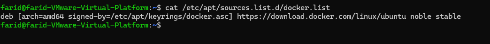
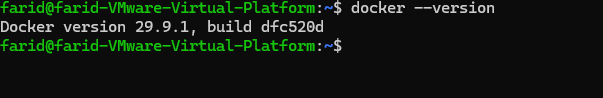
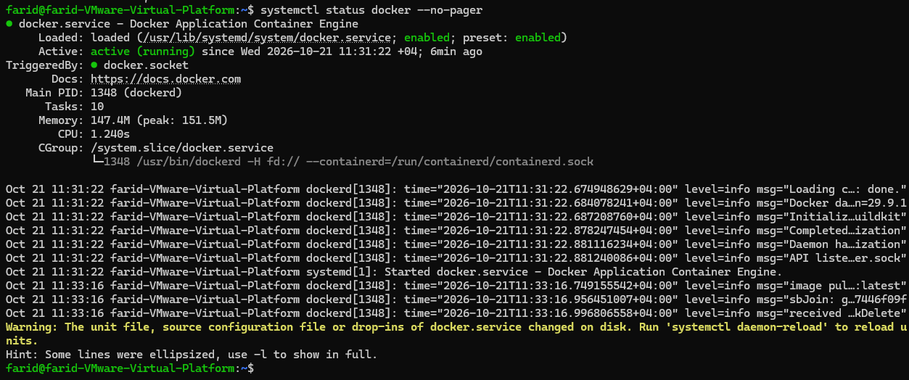
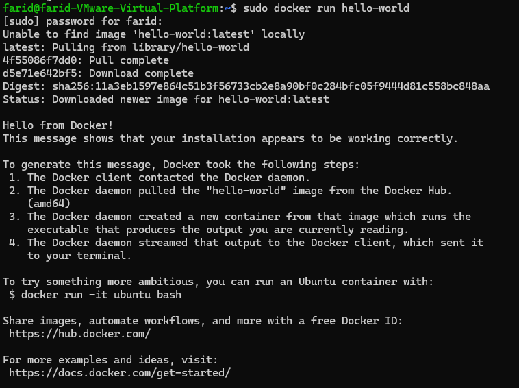
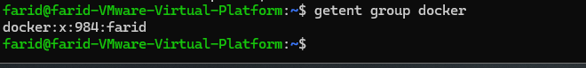
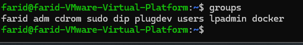
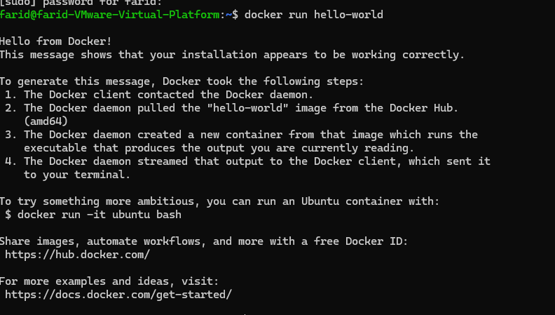

# Lab 1 - Docker Installation on Linux

## Objective
Install Docker Engine on an Ubuntu VM using the apt repository and verify that it works.

## Environment
- Ubuntu 24.04 (noble), VMware VM
- Docker version 29.9.1, build dfc520d

## Steps

### 1. Set up Docker's apt repository
Add Docker's official GPG key, add the repository to the apt sources in `/etc/apt/sources.list.d/docker.list`, and run `apt-get update`. All commands are in [commands.sh](commands.sh).

The `docker.list` file confirms the repository is configured:

```bash
cat /etc/apt/sources.list.d/docker.list
```


### 2. Install the Docker packages
```bash
sudo apt-get install docker-ce docker-ce-cli containerd.io docker-buildx-plugin docker-compose-plugin
```

Verify the installation:

```bash
docker --version
systemctl status docker --no-pager
```



The `docker.service` unit is `active (running)`.

### 3. Verify with hello-world
```bash
sudo docker run hello-world
```
The image was not available locally, so it was pulled from Docker Hub, and the container printed its confirmation message.



### 4. Run Docker without sudo
```bash
sudo groupadd docker
sudo usermod -aG docker $USER
newgrp docker
```
The `docker` group exists and the user is a member of it:

```bash
getent group docker
groups
```



Verify without sudo:

```bash
docker run hello-world
```


## Conclusion
Docker Engine was installed from the apt repository and verified with `hello-world`. Because the user was added to the `docker` group, Docker commands run without `sudo`.
