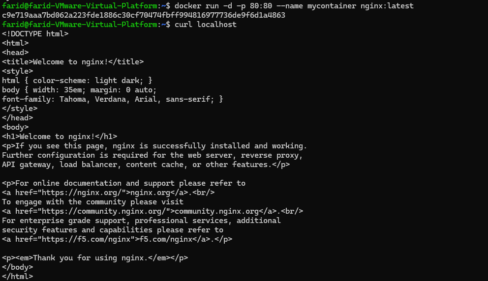
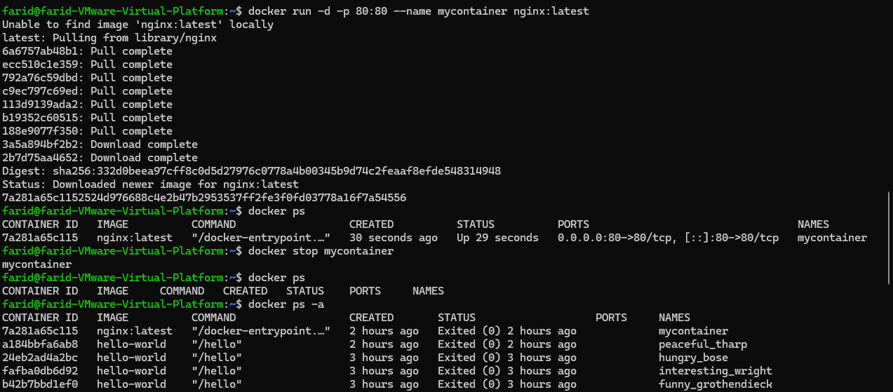
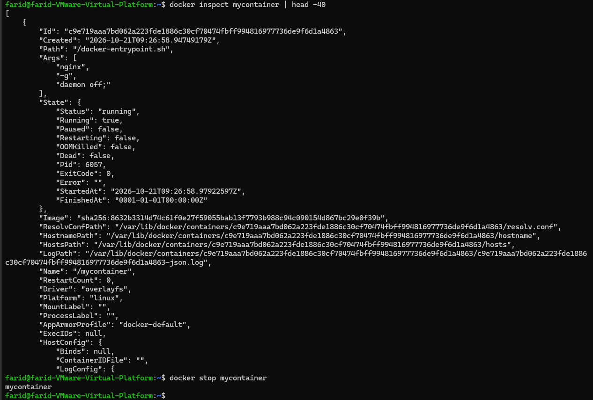
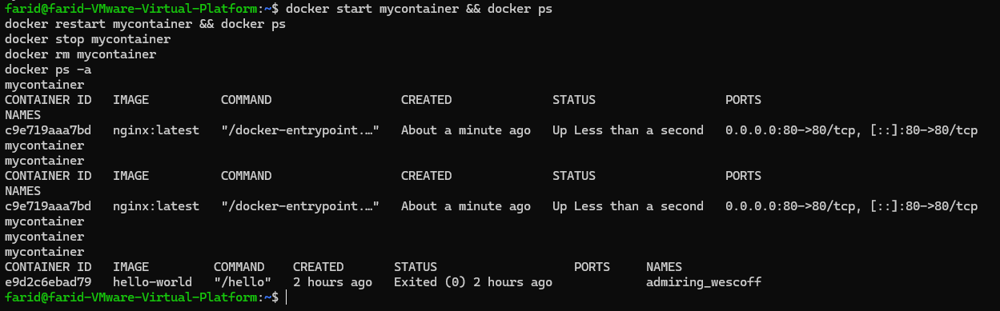
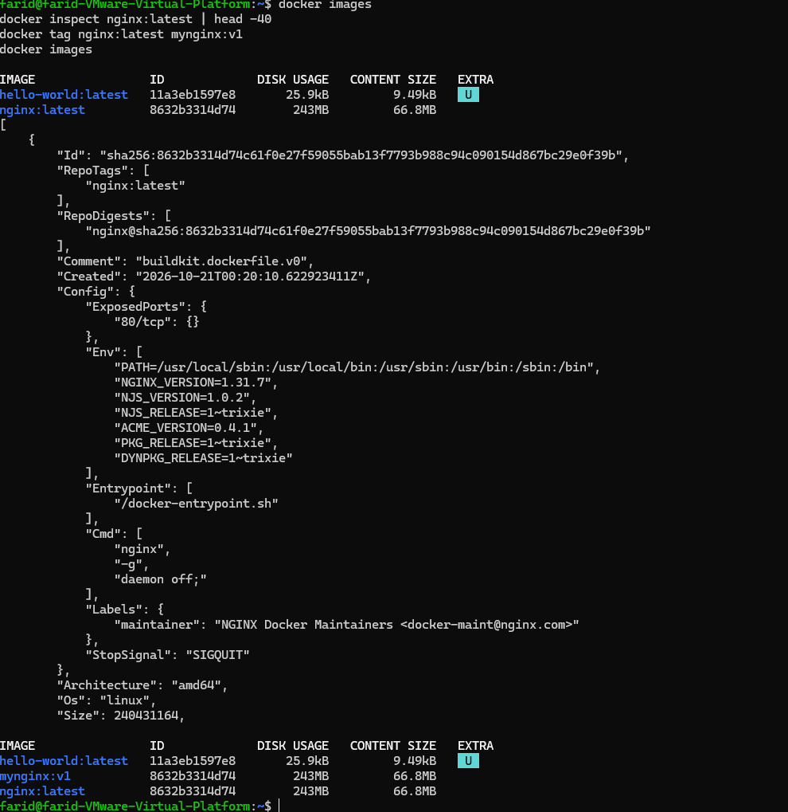
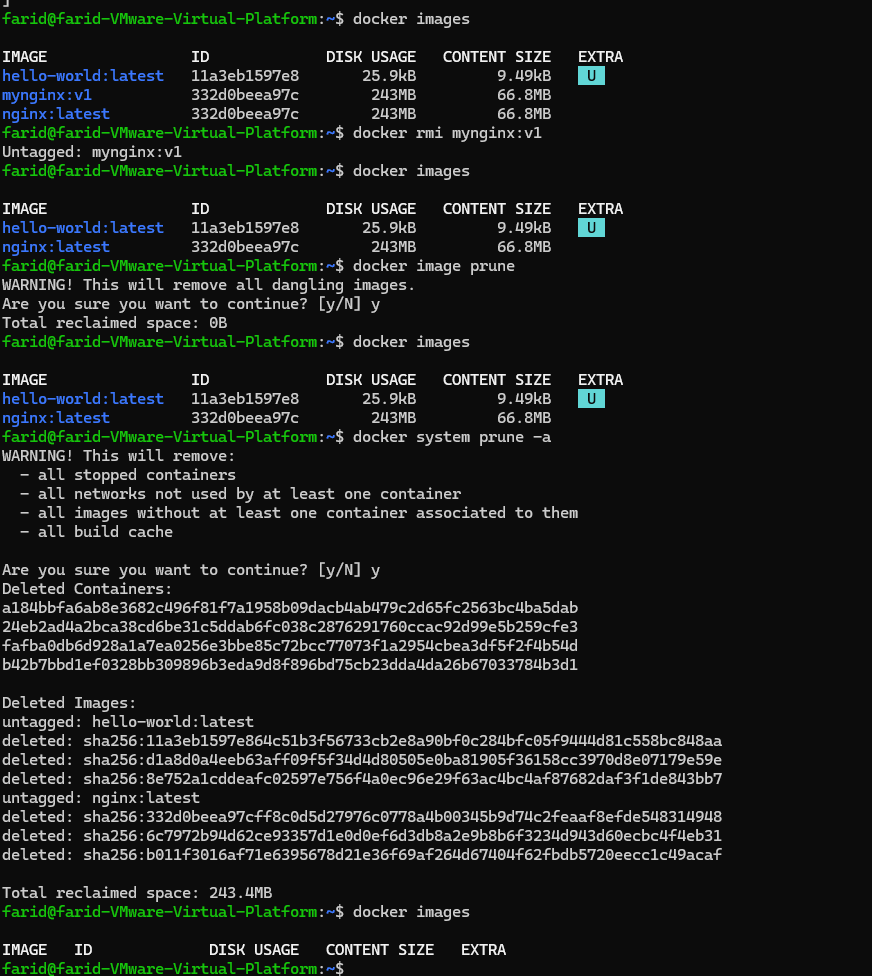

# Lab 2 - Docker Commands: Managing Containers and Images

## Objective
Practice the Docker commands used to manage containers and images.

## Environment
- Ubuntu 24.04 (noble), VMware VM
- Docker version 29.9.1

## Steps

### 1. Create a test container
```bash
docker run -d -p 80:80 --name mycontainer nginx:latest
curl localhost
```
`-d` runs the container in the background (detached mode), and `-p 80:80` maps host port 80 to container port 80. `curl` returns the nginx welcome page.



### 2. List, stop, list all
```bash
docker ps
docker stop mycontainer
docker ps
docker ps -a
```
`docker ps` shows only running containers. After the stop, the list is empty, while `docker ps -a` shows the container with an `Exited` status.



### 3. Inspect a container
```bash
docker inspect mycontainer | head -40
```
Returns low-level information about the container in JSON format (`State`, `Image`, `Name`, `HostConfig`, etc.).



### 4. Start, restart, remove
```bash
docker start mycontainer && docker ps
docker restart mycontainer && docker ps
docker stop mycontainer
docker rm mycontainer
docker ps -a
```
A container must be stopped before it can be removed. After `docker rm`, `mycontainer` no longer appears in `docker ps -a`.



### 5. Images: list, inspect, tag
```bash
docker images
docker inspect nginx:latest | head -40
docker tag nginx:latest mynginx:v1
docker images
```
`docker tag` does not copy the image; it adds a new name pointing to the same IMAGE ID. In the final `docker images` output, `nginx:latest` and `mynginx:v1` show the same ID.



### 6. Remove the tag and clean up
```bash
docker rmi mynginx:v1
docker image prune
docker system prune -a
```
- `docker rmi mynginx:v1` removes only the tag (`Untagged`); the image remains.
- `docker image prune` removes dangling images.
- `docker system prune -a` removes stopped containers, unused networks, and unused images.



## Conclusion
The container lifecycle (`run`, `stop`, `start`, `restart`, `rm`), image management (`images`, `inspect`, `tag`, `rmi`), and the differences between the prune commands were practiced hands-on.
